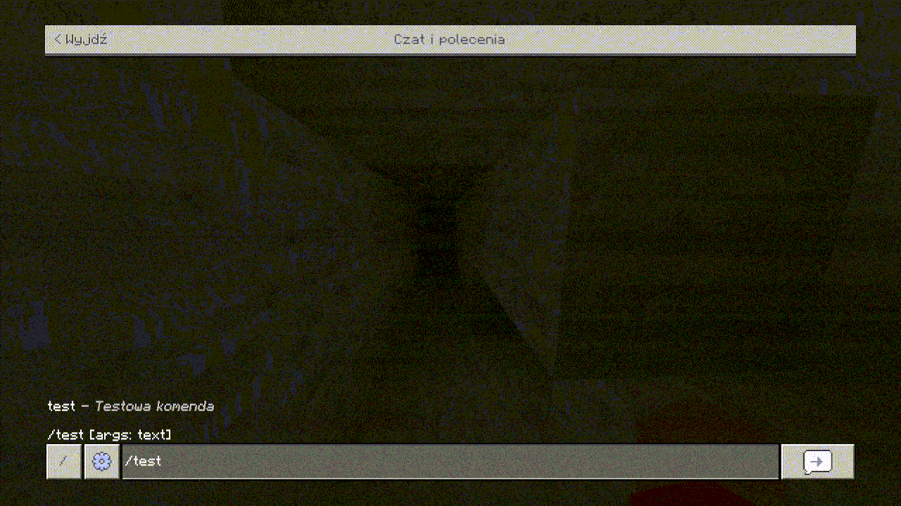

<div align="center">
    
# FakeInventories
✨A simple way to create a GUI on servers based on **PocketMine-MP 5.x** (API 5.0.0+)!✨
(https://youtu.be/D1NIx8E2UPg)
</div>
    
## Features
- Fast opening without any delay
- Opening a FakeInventory behind the player so the player cannot see it
- Simple un-clicking item
- Example patterns
- Simple API
- Tested on several servers

## Example


## Installation

1. Download plugin by clicking [here](https://github.com/venxsa/FakeInventories-PMMP)
2. Put the plugin into your plugins folder

## Usage

### Construct FakeInventory
```php
public function __construct() {
    // "Test1" it's a title
    // FakeInventorySize::LARGE_CHEST is a size of FakeInventory (for small chest just type FakeInventorySize::SMALL_CHEST)
    // The "true" at the end is whether the FakeInventory should appear behind the player
    
    parent::__construct("Test1", FakeInventorySize::LARGE_CHEST, true);
}
```

### Setting items (you need to add this function)
```php
public function setItems() : void {
    //$this->setItem(slot, item);
    $this->setItem(0, VanillaItems::DIAMOND());
}
```

### Filling the inventory
```php
// Fills every empty slot with the given item (default: gray stained glass pane with an empty name)
$this->fill();
$this->fill(VanillaBlocks::STAINED_GLASS_PANE()->setColor(DyeColor::BLACK())->asItem());

// Fills only the given slots, you can use one of the example patterns from FakeInventoryPatterns
$this->fillWithPattern(FakeInventoryPatterns::PATTERN_FILL_CORNERS);
$this->fillWithPattern(FakeInventoryPatterns::PATTERN_FILL_UP_AND_DOWN, VanillaItems::DIAMOND());
```

### At the end actions which are to be performed after clicking on an item
```php
// $player - Player which clicked on item
// $sourceItem - It's the item that was clicked
// $targetItem - It's the item that was clicked (almost useless)
// $slot - It's a slot which was clicked by player
public function onTransaction(Player $player, Item $sourceItem, Item $targetItem, int $slot) : bool {
    // returned value means whether transaction is cancelled or not
    // example if return value is true then transaction is cancelled otherwise not
    return true;
}
```

### Changing inventory
```php
$this->changeInventory($player, new YourFakeInventory());
```

### Closing inventory
```php
$this->closeFor($player);
```

### Opening inventory
```php
//if you want to open an inventory from a command level or another class, use
(new YourFakeInventory())->openFor([$player]);

//otherwise use this
$this->openFor([$player]);
```

### Un-clicking item
```php
$this->unClickItem($player);
```

### ✨That's all, your code should looks like this✨
```php
<?php

declare(strict_types=1);

namespace your\namespace;

use fakeinventories\inventories\FakeInventory;
use pocketmine\item\Item;
use pocketmine\item\ItemTypeIds;
use pocketmine\item\VanillaItems;
use pocketmine\player\Player;

class ExampleInventory extends FakeInventory {

    public function __construct() {
        parent::__construct("Second inventory");
    }

    public function setItems() : void {
        $this->setItem(0, VanillaItems::GOLD_INGOT());
    }

    public function onTransaction(Player $player, Item $sourceItem, Item $targetItem, int $slot) : bool {
        if($sourceItem->getTypeId() === ItemTypeIds::GOLD_INGOT) {
            $this->changeInventory($player, new YourInventory());
        }

        return true;
    }
}
```
## Credits

* Original Author: [iDarkQ](https://github.com/iDarkQ)
* Updated by: [venxsa](https://github.com/venxsa) *(updated to the latest version)*
